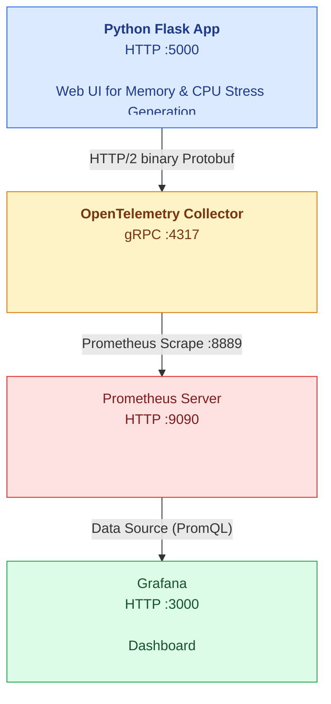
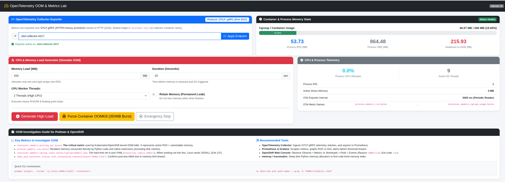
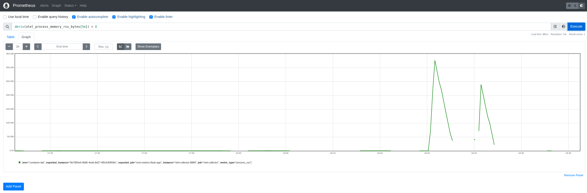
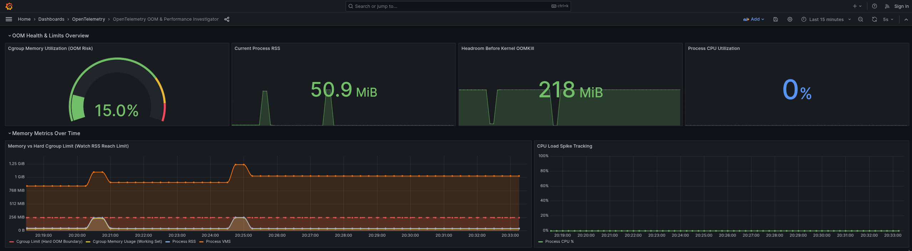

# OpenTelemetry OOM & Performance Metrics Lab for Python Flask in Podman & OpenShift

This repository contains a complete, production-grade guide and lab environment for investigating **Out-Of-Memory (OOM)** and high CPU events in a Python Flask application instrumented with **OpenTelemetry**, running in **Podman** and **OpenShift**.

---

## 1. What Are the Metrics to Investigate Container OOM?

When a container running in OpenShift or Podman experiences an OOM event, it is typically killed by the Linux kernel's **cgroup OOM Killer** (`SIGKILL`, exit code `137`). To diagnose why and when OOM occurs, you must inspect metrics across multiple layers:

### A. The Core Container Cgroup Metric (The Smoking Gun)
* **`container_memory_working_set_bytes`**:
  * **This is the exact metric Kubernetes/OpenShift uses to determine OOM.**
  * Formula: `working_set = memory.usage_in_bytes - memory.inactive_file` (or in cgroup v2: `memory.current - inactive_file`).
  * *Why this matters*: Unlike standard RSS or simple memory usage (which includes clean, evictable disk cache), `working_set` represents the memory that the container **cannot drop under memory pressure**. When `container_memory_working_set_bytes` hits `limits.memory` (cgroup `memory.max`), the kernel triggers `SIGKILL`.

### B. Process & OpenTelemetry Runtime Metrics
* **`process_memory_rss_bytes`** (Resident Set Size):
  * Physical RAM actively allocated to the Python process (heap, stack, objects, native C extensions).
* **`process_memory_vms_bytes`** (Virtual Memory Size):
  * Total address space requested by the process. High VMS with low RSS usually indicates memory mapping or thread stacks, not an immediate OOM risk.
* **`container_memory_cgroup_limit_bytes`** (or `cgroup/memory.max`):
  * The memory boundary enforced on the container (e.g. 256 MiB).
* **`container_memory_cgroup_utilization_ratio`**:
  * Ratio: `usage / limit`. If this reaches `1.0` (100%), an OOM kill is imminent.
* **Memory Headroom**:
  * `limit_bytes - working_set_bytes`: The number of bytes remaining before the pod is terminated.

### C. Cluster & Kubernetes Lifecycle Metrics
* **`kube_pod_container_status_last_terminated_reason{reason="OOMKilled"}`**:
  * Emitted by `kube-state-metrics` in OpenShift. Value `1` confirms that the container terminated specifically due to an OOMKill.
* **`container_oom_events_total`**:
  * Counter emitted by cAdvisor whenever the kernel cgroup OOM killer fires for a container.

---

## 2. What Tools to Use to Analyse OpenTelemetry Metrics?

| Tool | Purpose & Role |
| :--- | :--- |
| **OpenTelemetry Collector** | Ingests telemetry from application pods via **OTLP gRPC (Port 4317)**, batches metrics, applies memory limits, and routes to backends. |
| **Prometheus** | Scrapes the OpenTelemetry Collector's Prometheus exporter (Port `8889`), stores time-series data, and computes alerts. |
| **Grafana** | Visualizes memory headroom, RSS vs Cgroup limit, CPU spikes, and provides alerting dashboards. |
| **OpenShift Web Console** | Built-in *Observe > Metrics* (Thanos/Prometheus) and *Workloads > Pods > Events* to view `OOMKilled` warnings and event timelines. |
| **Python Profilers (Memray / tracemalloc)** | Deep profiling tools used inside the Python runtime to pinpoint the exact line of Python code or module leaking heap allocations. |

---

## 3. Architecture & Protocol Details




> **Why gRPC (Port 4317) is used as default non-HTTP protocol:**
> OTLP supports both gRPC (port 4317) and HTTP (port 4318). gRPC uses HTTP/2 with binary protocol buffers (`protobuf`), providing lower overhead, multiplexed streaming connections, and superior performance for continuous metric streaming.

---

## 4. Developer Workflow

### Step 1: Test Locally (Python Virtual Environment)
1. Set up virtual environment and install dependencies:
   ```bash
   make venv
   make install
   ```
2. Start the application locally:
   ```bash
   make run-local
   ```
3. Open your browser at `http://localhost:5000`:
   - Inspect live process RSS and CPU usage.
   - Configure OTel Collector endpoint (default `localhost:4317`).
   - Trigger a stress test (e.g. 200MB memory for 30s with 2 CPU workers).

4. Or trigger a stress test via CLI:
   ```bash
   make test-local-stress
   ```

---

### Step 2: Test Podman Container Locally
1. Build the rootless-ready container:
   ```bash
   make build-container
   ```
2. Run the container with an explicit **256MB memory limit** in Podman:
   ```bash
   make run-container
   ```
3. Observe container metrics with Podman CLI:
   ```bash
   podman stats oom-flask-app --no-stream
   ```
4. Access UI at `http://localhost:5000`. Notice that the Cgroup badge now reports `CGROUP: V2` (or V1) with a hard limit of `256 MB`.
5. Force an immediate container OOMKill:
   ```bash
   make test-container-oom
   ```
   *The container attempts to allocate 350MB against a 256MB cgroup limit. Podman terminates the container with `ExitCode: 137` and `OOMKilled: true`.*

---

### Step 2b: Publish Image to Docker Hub
1. Authenticate with Docker Hub:
   ```bash
   make docker-login
   ```
2. Build, tag, and publish to `stefanbudim/oom-flask-app:latest`:
   ```bash
   make publish-image
   # or: make push
   ```
   *Published repository: [hub.docker.com/u/stefanbudim](https://hub.docker.com/u/stefanbudim)*

---

### Step 3: Test with Prometheus & Grafana in Containers
Start the full observability pipeline (Flask App + OTel Collector + Prometheus + Grafana):
```bash
make up-stack
```

Access the services:
* **Flask App & Stress UI**: [http://localhost:5000](http://localhost:5000)
* **OpenTelemetry Collector gRPC**: `localhost:4317` (Metrics exporter: [http://localhost:8889/metrics](http://localhost:8889/metrics))
* **Prometheus UI**: [http://localhost:9090](http://localhost:9090)
* **Grafana Dashboard**: [http://localhost:3000](http://localhost:3000) *(Auto-authenticated, pre-configured dashboard "OpenTelemetry OOM & Performance Investigator")*

To shut down the stack:
```bash
make down-stack
```

---

### Step 4: Test in OpenShift
1. Log into your OpenShift cluster:
   ```bash
   oc login --token=<YOUR_TOKEN> --server=<YOUR_API_URL>
   oc project <YOUR_PROJECT>
   ```
2. Deploy the OpenTelemetry Collector and Flask Application:
   ```bash
   make deploy-openshift
   ```
3. Retrieve the public route to access the UI:
   ```bash
   oc get route oom-flask-app -o jsonpath='{.spec.host}'
   ```
4. Trigger an OOM event from the UI (click "Force Container OOMKill") or via CLI:
   ```bash
   ROUTE_URL=$(oc get route oom-flask-app -o jsonpath='{.spec.host}')
   curl -X POST http://$ROUTE_URL/api/stress/start \
     -H "Content-Type: application/json" \
     -d '{"load_mb": 400, "duration_sec": 60, "cpu_workers": 2, "leak_permanently": true}'
   ```
5. Inspect the OpenShift termination status:
   ```bash
   make test-openshift-oom
   ```
   You will see:
   ```
   Reason: OOMKilled
   Exit Code: 137
   Last State: Terminated
   ```

---

## 5. Key PromQL Queries for OOM Investigation

* **Pod Working Set vs Limit (OpenShift User Workload Monitoring)**:
  ```promql
  container_memory_working_set_bytes{container="app"}
    /
  container_spec_memory_limit_bytes{container="app"} > 0.85
  ```
* **Memory Headroom (Bytes until OOMKill)**:
  ```promql
  otel_container_memory_cgroup_limit_bytes - otel_container_memory_cgroup_usage_bytes
  ```
* **Process RSS Growth Rate (Detecting Memory Leaks)**:
  ```promql
  deriv(otel_process_memory_rss_bytes[5m]) > 0
  ```
* **OOM Kill Events Detected by Cluster**:
  ```promql
  increase(container_oom_events_total{container="app"}[15m]) > 0
  ```


# Screenshots









